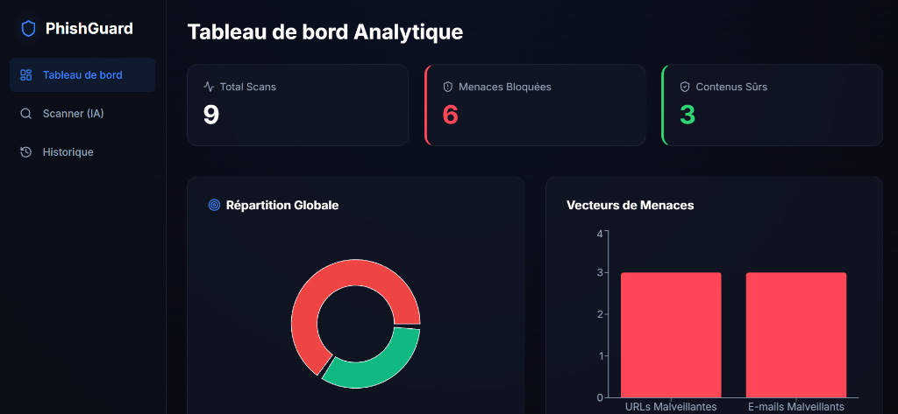
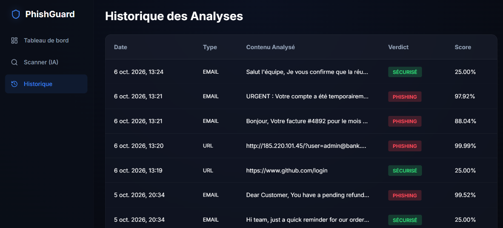
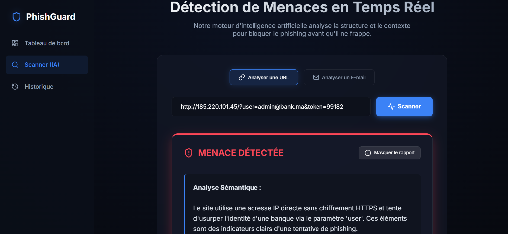
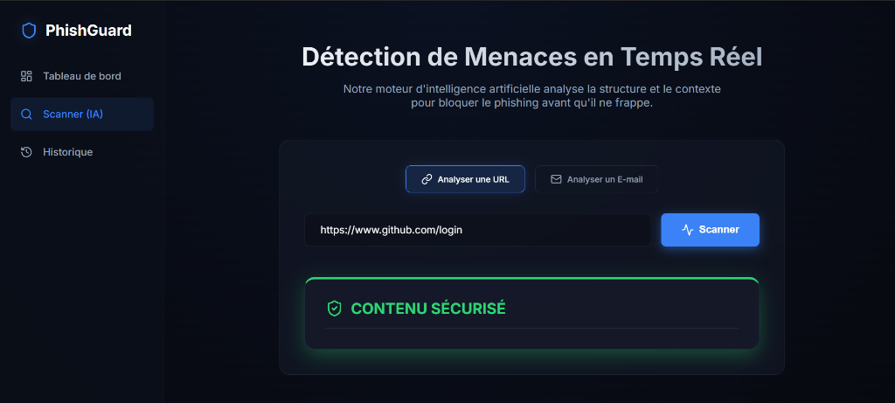
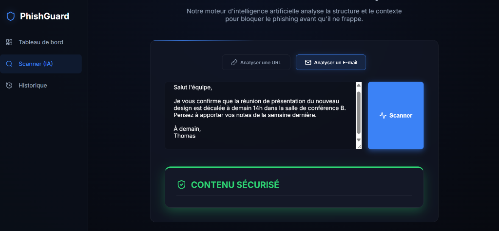
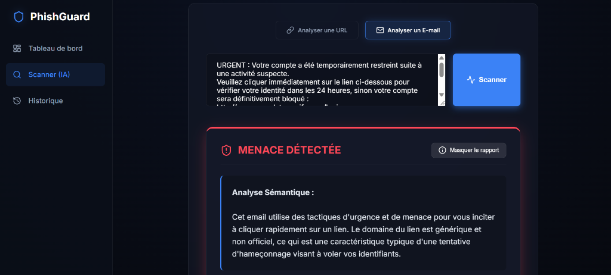

# Réalisation d'une application intelligente de détection de Phishing par Machine Learning

[](https://www.python.org/)
[](https://www.djangoproject.com/)
[](https://reactjs.org/)
[](https://www.postgresql.org/)
[](https://www.docker.com/)

## Présentation
Cette application est un système de détection hybride conçu pour identifier et neutraliser les tentatives de phishing via les URLs et les E-mails. 

Développé dans le cadre d'un Projet de Fin d'Année (PFA), ce projet comble le fossé entre les heuristiques classiques du Machine Learning et l'Intelligence Artificielle Générative moderne, le tout packagé dans une architecture microservices prête pour la production.

## Architecture et Stack Technique
Le projet repose sur une architecture microservices entièrement conteneurisée pour garantir une isolation stricte et une portabilité totale de l'environnement.

*   **Ingénierie des Données et Machine Learning (Cœur) :**
    *   **Traitement des Données :** Pipelines NLP approfondis (Tokenisation, Lemmatisation, TF-IDF) et extraction de caractéristiques mathématiques (Entropie, détection d'obfuscation d'IP).
    *   **Algorithmes :** Implémentation d'un Vote Majoritaire (Voting Classifier) assemblant Random Forest, Support Vector Machines (SVM) et XGBoost.
*   **Système Backend (API) :**
    *   **Framework :** Django REST Framework agissant comme système nerveux central.
    *   **Base de Données :** PostgreSQL 15 pour une persistance robuste et conforme aux normes ACID des historiques de scan.
*   **Couche IA Générative (Pipeline à deux niveaux) :**
    *   **Intégration :** Google GenAI SDK (Gemini). *Note : L'architecture est totalement modulaire. Il est possible de basculer sur OpenAI (ChatGPT) ou Anthropic (Claude) en adaptant uniquement le service IA dans le fichier `api/views.py`.*
    *   **Mécanisme :** Agit comme couche de validation secondaire. Si les modèles ML primaires déclenchent une alerte de menace, le LLM analyse le contexte sémantique. S'il détermine qu'il s'agit d'un Faux Positif, il écrase la décision du ML, réduisant ainsi drastiquement les taux de faux positifs.
*   **Système Frontend (Client) :**
    *   **Framework :** React (Vite) utilisant du CSS pur pour un design system "Dark Cyber" de type glassmorphism.
    *   **Analytique :** Intégration de Recharts pour la visualisation dynamique et en temps réel des vecteurs de menaces.

## Fonctionnalités Principales
1.  **Pipeline de Validation à Deux Niveaux :** Le ML fournit une classification rapide ; l'IA générative fournit un audit sémantique profond et valide le verdict final.
2.  **Scanner de Menaces Universel :** Une interface unifiée traitant à la fois les URLs malveillantes et les e-mails de phishing sophistiqués (y compris la fraude au président).
3.  **Tableau de Bord de Threat Intelligence :** Métriques en temps réel et graphiques dynamiques représentant les menaces bloquées.
4.  **Historique et Audit :** Journalisation persistante en base de données de tous les scans du système.

---

## Aperçu de l'Application

La plateforme propose une interface épurée "Dark Cyber" pour l'analyse des menaces.

### Tableau de Bord Analytique


### Historique des Analyses


### Scanner (IA) - URL de Phishing


### Scanner (IA) - URL Saine


### Scanner (IA) - E-mail Sain


### Scanner (IA) - E-mail de Phishing


---

## Guide de Déploiement et Quickstart

Cette application est strictement conteneurisée. Les instructions suivantes permettent à tout utilisateur de lancer l'infrastructure complète localement sans aucun problème de portabilité ou de conflit logiciel.

### Prérequis
*   [Docker Engine](https://docs.docker.com/engine/install/)
*   [Docker Compose](https://docs.docker.com/compose/install/)

### Étape 1 : Cloner le Dépôt
```bash
git clone https://github.com/votre-nom/phishguard-ai.git
cd phishguard-ai
```

### Étape 2 : Configuration de l'Environnement
La couche d'IA Générative nécessite une clé d'API Google Gemini valide pour fonctionner.
1. Naviguez dans le dossier backend : `cd backend`
2. Créez un fichier nommé `.env` et insérez votre clé API :
```env
GEMINI_API_KEY="VOTRE_CLE_API_GOOGLE_GEMINI_ICI"
```
*(Note : Ne commitez pas le fichier `.env` sur le contrôle de version).*

### Étape 3 : Lancer l'Infrastructure
Retournez à la racine du projet et exécutez Docker Compose :
```bash
cd ..
docker-compose up --build
```

Docker orchestrera automatiquement les actions suivantes :
*   Provisionnement et initialisation de la base de données PostgreSQL.
*   Construction de l'environnement Python, application des migrations de base de données, et démarrage de l'API Django sur le **port 8000**.
*   Construction de l'environnement Node.js et démarrage du Frontend React sur le **port 5173**.

---

## Tester l'Application

Une fois les conteneurs Docker opérationnels, ouvrez votre navigateur web et rendez-vous sur :
**http://localhost:5173**

Pour évaluer les capacités de l'architecture hybride, naviguez vers la section **Scanner (IA)** et exécutez les 4 tests distincts suivants :

### Test 1 : URL Saine (Légitime)
*   **Entrée :** `https://www.linkedin.com/feed/`
*   **Résultat Attendu :** Le modèle d'analyse heuristique ne trouve aucun vecteur d'attaque. Verdict : **SÉCURISÉ**.

### Test 2 : URL de Phishing (Attaque par typosquatting)
*   **Entrée :** `http://secure-login.paypal-verify-update.com/signin`
*   **Résultat Attendu :** L'URL contourne les listes noires mais échoue à l'analyse structurelle du ML (sous-domaines excessifs, pas de HTTPS). Verdict : **PHISHING DÉTECTÉ**.

### Test 3 : E-mail Sain (Communication d'Entreprise)
*   **Entrée :** `Bonjour, voici le compte rendu de notre appel d'hier. Le document de synthèse est en pièce jointe. N'hésitez pas si vous avez des questions. Cordialement, Sarah.`
*   **Résultat Attendu :** L'analyse sémantique détermine un contexte inoffensif. Verdict : **SÉCURISÉ**.

### Test 4 : E-mail de Phishing (Ingénierie Sociale Avancée)
*   **Entrée :** `Félicitations ! Vous avez été sélectionné pour recevoir le tout dernier iPhone 15 gratuit. Cliquez sur le lien ci-dessous et connectez-vous avec vos identifiants pour régler les frais de livraison de 2 euros : http://claim-prize-now-apple.com`
*   **Résultat Attendu :** L'IA Générative détecte la promesse de récompense factice et l'incitation à cliquer. Verdict : **PHISHING DÉTECTÉ**, avec explication détaillée du SOC Virtuel.

